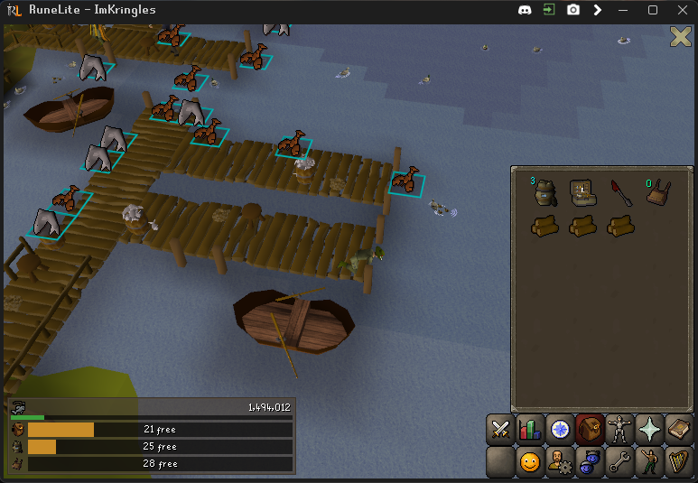
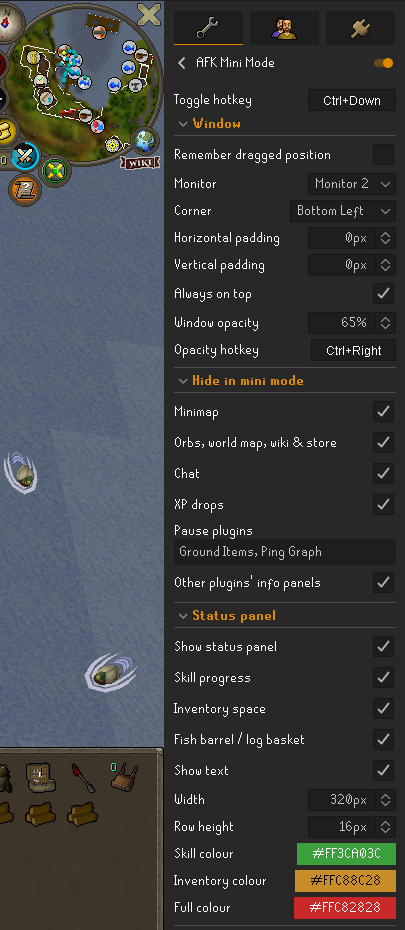

# AFK Mini Mode
For AFK skilling you only glance at. One hotkey shrinks RuneLite to its smallest size, keeps it on top in a corner (or wherever you last dragged it), hides UI clutter and shows a small skilling status bar. Press it again to put everything back.

| Mini mode | Settings |
| --- | --- |
|  |  |

## Setup
1. Set **Toggle hotkey** in the plugin config.
2. Use a **resizable** game layout (Settings > Display). UI hiding does nothing in fixed mode.
3. To hide the sidebar too, use RuneLite's own **Sidebar toggle** hotkey (RuneLite config > Window Settings) on a *different* key. Plugins can't toggle the sidebar, and RuneLite's sidebar hotkey swallows its key, so the two can't share one.

## Features
- **Window:** smallest legal size (765x503 game area), always on top, snaps to a corner. Drag it by the title bar while in mini mode and it reopens there next time. Changing the corner, monitor or padding resets that and moves it straight away.
- **See-through:** optional window opacity while in mini mode, plus a hotkey to flip between that and fully solid.
- **Always put back:** your window size, always-on-top and opacity are restored when you leave mini mode, turn the plugin off or close RuneLite. If RuneLite is killed or crashes in mini mode, they're restored the next time it starts.
- **Hide:** minimap; orbs, world map, wiki, activity adviser and store buttons; chat and the promo banner above it (including dialogues and make-X/amount prompts, so leave mini mode to use those); XP drops.
- **Other plugins' info panels:** hidden while in mini mode (e.g. Fishing catch stats, ping, infoboxes). The plugins keep running, so world highlights like fishing spots stay.
- **Pause plugins:** comma-separated plugin names (default `Ground Items`) are fully paused while in mini mode and resumed when you leave.
- **Status panel**, pinned to the bottom-left where the chat was:
  - skill row, styled like the game's XP counter: skill icon, total XP, and a thin bar to the next level, for the skill you last gained XP in. If you keep XP drops visible, the game's own XP counter moves to the top-left instead and this row is skipped
  - inventory icon: free inventory slots
  - Motherlode Mine sack (only inside the mine): free space, counting the pay-dirt you carry, as the game reports it. The game's own sack counter is hidden in mini mode; hover the row for the sack count and golden nuggets carried
  - container rows: free space in an open fish barrel, log basket, coal bag (27, or 36 with a Smithing/max cape) or gem bag/sack (60 per gem; the bar shows the fullest gem, hover for each). Each shows "Check ..." until the count is exact, so use **Check** on it once. The game doesn't send these counts, so they're tracked from chat messages and inventory changes:
    - coal bag: mined coal (plus Celestial ring / Varrock platebody bonus ore), and coal used by Superheat Item, handled exactly as in TicTac7x's Charges plugin: inventory coal first, the rest from the bag, on the Smithing XP drop
    - gem bag/sack: gems mined, stolen, picked up or telegrabbed into an open bag, and gems moved in or out by hand

The client can't go below the game's minimum size. Hiding UI frees that space for the game view; it doesn't shrink the window further.

## Credits
Fish barrel and log basket tracking are ported from these BSD-2 plugins, with their copyright notices kept in the source files:
- [Fish Barrel](https://github.com/molo-pl/runelite-plugins) by molo-pl
- [Log Basket](https://github.com/aidanmastro/log-basket-plugin) by aidanmastro

Coal bag and gem bag tracking follow the game messages and handling worked out by these BSD-2 plugins, with their copyright notices kept in the source files:
- [Coal Bag](https://github.com/WolffTech/coal-bag-plugin) by Nick Wolff
- [Gem Sack](https://github.com/serenibyss/osrs-gem-sack-plugin) by serenibyss
- [Charges](https://github.com/TicTac7x/runelite-plugins/tree/plugin-charges) by TicTac7x (including Superheat Item coal use)

The Motherlode sack sizes match RuneLite's own Motherlode plugin.
